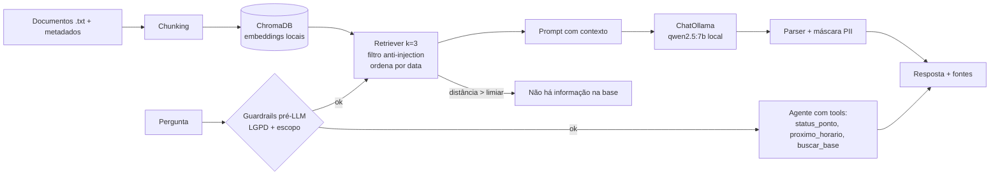

# CitizenTech — Assistente da Linha 714 "Vai-e-Vem" (Vila Serena)
**GS 2026.2 · Prompt and Artificial Intelligence · FIAP**
Autor (individual): Kevin Rodrigues de Melo — RM571777 · Turma: 1CCPG · Frente A (Mobilidade urbana)

## Descrição
Assistente que responde perguntas de cidadãos sobre a Linha 714 (itinerário, horários, acessibilidade, gratuidades) **com citação do doc_id**, recusa quando não há informação, usa **ferramentas** para calcular horários/status de pontos, tem interface Gradio, guardrails e avaliação RAGAS medida.

## Diagrama do pipeline

## Armadilha da base documental (declarada)
- **Desatualização/contradição:** o Aviso 014/2026 e a Tabela 022/2026 (20/02/2026) dizem que o ponto P-0412 (Rua das Acácias) está ativo todos os dias e que aos domingos há partidas das 07:00 às 20:00 (60 min). A **Portaria 087/2026 (15/09/2026)**, mais recente, suprime o P-0412 aos domingos/feriados e muda os horários para 08:00–17:00 (90 min). O sistema deve preferir a Portaria.
- **Faixa condicional:** gratuidade aos domingos para 60–64 anos **somente até 31/12/2026** (Portaria, Art. 3º).
- **Detalhe só no apoio:** pontos acessíveis (P-0412 e P-0418) aparecem apenas na seção 3 "Observações operacionais" do doc_01.
- Os 3 documentos foram redigidos para este trabalho (município e normas fictícios), com apoio de IA e revisão do autor.

## Instruções de execução
1. Abra `1_Notebook_GS2026_2.ipynb` no Google Colab.
2. Selecione GPU: Runtime → Alterar tipo de ambiente de execução → T4 GPU. O notebook instala o Ollama e baixa o `qwen2.5:7b` sozinho (`USAR_NUVEM = False`). Para usar a nuvem, troque a flag para `True` e crie o Secret `OLLAMA_API_KEY`.
3. `Runtime → Run all`. Antes, escreva o `ground_truth` das 6 perguntas na Seção 7 (célula sinalizada).
4. O notebook gera `3_avaliacao_ragas.json`; baixe-o. A base `.txt` é recriada pelo próprio notebook.

## Decisões técnicas
| Decisão | Escolha | Motivo |
|---|---|---|
| LLM | `qwen2.5:7b` via Ollama **local** no Colab (GPU T4); a nuvem (`gpt-oss:20b`) fica atrás da flag `USAR_NUVEM` | a conta gratuita da nuvem não tinha cota/crédito (erro 402); local não consome cota, sem API paga e suporta tool calling |
| Embeddings | `paraphrase-multilingual-MiniLM-L12-v2` local | não consome cota do Ollama; bom em português |
| Chunking | 500 caracteres, overlap 80 (comparado com 1000/150; tabela na Seção 1 do notebook e no print 01) | os documentos são curtos e organizados em artigos/seções pequenas; chunks menores isolam cada regra e evitam misturar horário antigo com o novo |
| k do retriever | 3 | prompt curto (menos tokens) e suficiente para juntar Portaria + Aviso |
| Limiar de distância | 0,65 (cosseno) | calibrado com perguntas dentro/fora da base |
| Agente | function calling manual (`bind_tools`) com limite de 6 chamadas | trace explícito e sem loop |

## Guardrails
Escopo (classificador), prompt injection na fonte (filtro por padrões + prompt trata trechos como dados), LGPD (pedidos de dados de moradores + máscara de CPF/telefone) e limite de confiança. Há testes automatizados dos determinísticos (`testes_guardrails()`).

## Avaliação RAGAS
- 6 perguntas (3 simples + 3 armadilha) com ground truth escrito por mim. Métricas: faithfulness, response_relevancy, context_precision, context_recall.
- **Juiz:** LLM **local** (`qwen2.5:7b`) + embeddings locais, configurados explicitamente (`llm=` e `embeddings=`). Por ser um juiz pequeno, os valores são tratados como comparativos, não como valor absoluto.
- Juiz e embeddings configurados explicitamente (`llm=` e `embeddings=`). Valores medidos (arquivo `3_avaliacao_ragas.json`):

| Métrica | Média geral | Nível 1 (simples) | Nível 2 (armadilha) |
|---|---|---|---|
| faithfulness | 0,75 | 0,78 | 0,72 |
| answer_relevancy | 0,76 | 0,67 | 0,84 |
| context_precision | 0,35 | 0,42 | 0,28 |
| context_recall | 0,83 | 1,00 | 0,67 |

- **Leitura:** o recall é alto (o trecho certo costuma ser recuperado), mas a precision é baixa: com k=3 vêm trechos desnecessários junto. As perguntas de armadilha são mais frágeis que as simples.
- **O RAGAS não mede correção:** na pergunta da última partida aos domingos a resposta foi 20:00 (Tabela de fevereiro) em vez de 17:00 (Portaria 087/2026), mas faithfulness e recall deram 1,0, porque a resposta é fiel ao trecho que o modelo usou. A Portaria estava entre os trechos recuperados (primeiro trecho); o erro foi do modelo, que não aplicou a regra de que a norma mais recente prevalece.
- **Pergunta dos 62 anos:** a resposta saiu errada e contraditória (disse que paga; o Art. 3º da Portaria dá gratuidade de 60 a 64 anos aos domingos até 31/12/2026).
- **Limitação da avaliação (honesta):** os ground truths das perguntas 4 (Rua das Acácias) e 6 (62 anos) foram escritos de forma divergente/incompleta em relação aos documentos (o da 4 diz que o P-0412 atende aos domingos, o que a Portaria Art. 1º contradiz; o da 6 cita só a gratuidade de 65+). Por isso, o recall/precision 0 nessas perguntas reflete essa divergência, e não só o retriever. Também o juiz é um modelo pequeno local, então os valores são comparativos.
- **Melhoria proposta (não testada):** resolver o conflito de datas no código (marcar o documento mais recente como "PREVALECE" e descartar trechos de documentos revogados) e corrigir os ground truths 4 e 6; depois medir de novo pelo RAGAS.

## Prints
1. Comparação de chunking (500/80 × 1000/150): 
2. Busca semântica com `distance`: 
3. RAG com 3+ respostas com fonte e "não sei": 
4. Trace do agente (thought → action → observation): 
5. Interface Gradio com histórico e fontes: 
6. Guardrails (escopo, injection na fonte, LGPD; limite de confiança no print 3): 
7. Tabela do RAGAS: 

## Limitações e custo
- Base pequena e fictícia; vigência por documento é inferida pela data de publicação.
- Custo por pergunta: RAG ≈ 1 chamada (+1 do guardrail de escopo); agente ≈ 2–7; RAGAS ≈ 6 × ~7 chamadas. Como o modelo roda local, não há cota nem custo por chamada; o custo é tempo de GPU (a execução completa leva alguns minutos na T4).
